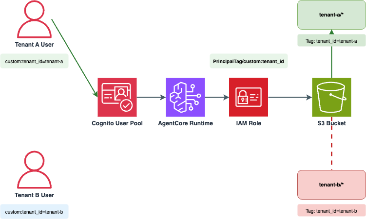

# multi-tenant-agentcore

Amazon Bedrock AgentCore Runtime でマルチテナントを実現するサンプルです。
属性ベースのアクセス制御（ABAC）を用いて、テナントごとに S3 オブジェクトへのアクセスを分離します。



## 構成

```
.
├── cdk/                  # AWS リソースのデプロイ (TypeScript)
└── agents/abac_agent/    # ABAC エージェント (Python)
```

## cdk

AWS CDK (TypeScript) で以下のリソースをデプロイします。

- Amazon Cognito User Pool（`custom:tenant_id` カスタム属性 + Pre Token Generation Lambda）
- Amazon S3 バケット（マルチテナント用）
- IAM ロール `ABACTenantRole`（S3 オブジェクトタグと PrincipalTag を照合する ABAC ポリシー）
- Bedrock AgentCore Runtime（`abac_agent`）

```bash
cd cdk
npm install
cdk bootstrap   # 初回のみ
cdk deploy
```

## agents/abac_agent

Bedrock AgentCore Runtime 上で動作する Python エージェント（Strands Agents）です。

- `Authorization` ヘッダーのアクセストークンで Cognito 認証を検証
- `X-Amzn-Bedrock-AgentCore-Runtime-Custom-IdToken` ヘッダーの ID トークンから `custom:tenant_id` を抽出
- セッションタグとして `custom:tenant_id` を付与しながら ABAC ロールへ `AssumeRole` を実行
- 取得した一時認証情報（PrincipalTag に `custom:tenant_id` が付与済み）で S3 にアクセス
- IAM ポリシーの条件によりテナント自身のオブジェクトのみ操作可能

```bash
cd agents/abac_agent
pip install -r requirements.txt
```

## 動作フロー

1. ユーザーが Cognito で認証 → `custom:tenant_id` クレーム入りトークンを取得
2. Pre Token Generation Lambda により、ID トークンとアクセストークンに `custom:tenant_id` クレームが追加される
3. AgentCore Runtime を呼び出し（アクセストークン + ID トークンをヘッダーに付与）
4. エージェントが ID トークンから `custom:tenant_id` を抽出し、セッションタグとして付与しながら ABAC ロールへ `AssumeRole` を実行
5. セッションタグが `PrincipalTag/custom:tenant_id` として設定される
6. IAM ポリシーの条件により、S3 オブジェクトのタグと PrincipalTag が照合される
7. 一致した場合のみアクセスが許可される

## 検証手順

### 1. テストユーザーの作成

デプロイ後、Cognito にテストユーザーを作成し、`custom:tenant_id` 属性を設定します。

```bash
# Tenant A のユーザーを作成
aws cognito-idp admin-create-user \
  --user-pool-id ${USER_POOL_ID} \
  --username ${YOUR_EMAIL_ADDRESS} \
  --user-attributes Name=email,Value=${YOUR_EMAIL_ADDRESS} \
                    Name=custom:tenant_id,Value=tenant-a \
  --message-action SUPPRESS

# パスワードを設定
aws cognito-idp admin-set-user-password \
  --user-pool-id ${USER_POOL_ID} \
  --username ${YOUR_EMAIL_ADDRESS} \
  --password ${YOUR_PASSWORD} \
  --permanent
```

### 2. テストファイルの作成

S3 バケットにテスト用のオブジェクトを配置し、適切な `tenant_id` タグを付与します。

```bash
# Tenant A のファイルを作成
echo "This is tenant-a data" > tenant-a-file.txt
aws s3api put-object --bucket ${MULTI_TENANT_BUCKET} --key "tenant-a/file1.txt" \
  --body "tenant-a-file.txt" --tagging "tenant_id=tenant-a"

# Tenant B のファイルを作成
echo "This is tenant-b data" > tenant-b-file.txt
aws s3api put-object --bucket ${MULTI_TENANT_BUCKET} --key "tenant-b/file1.txt" \
  --body "tenant-b-file.txt" --tagging "tenant_id=tenant-b"
```

### 3. AgentCore Runtime の呼び出し

テスト用スクリプトを使用して、AgentCore Runtime を呼び出します。

```bash
# Tenant A のデータにアクセス（成功）
bash ./scripts/run_test.sh "tenant-aフォルダのファイル一覧を表示してください"

# Tenant B のデータにアクセス（失敗）
bash ./scripts/run_test.sh "tenant-bフォルダのファイル一覧を表示してください"
```

## 注意事項

CDK による AgentCore のデプロイには alpha 版の L2 Construct (`@aws-cdk/aws-bedrock-agentcore-alpha`) を使用しています。今後の変更により動作しなくなる可能性があります。
